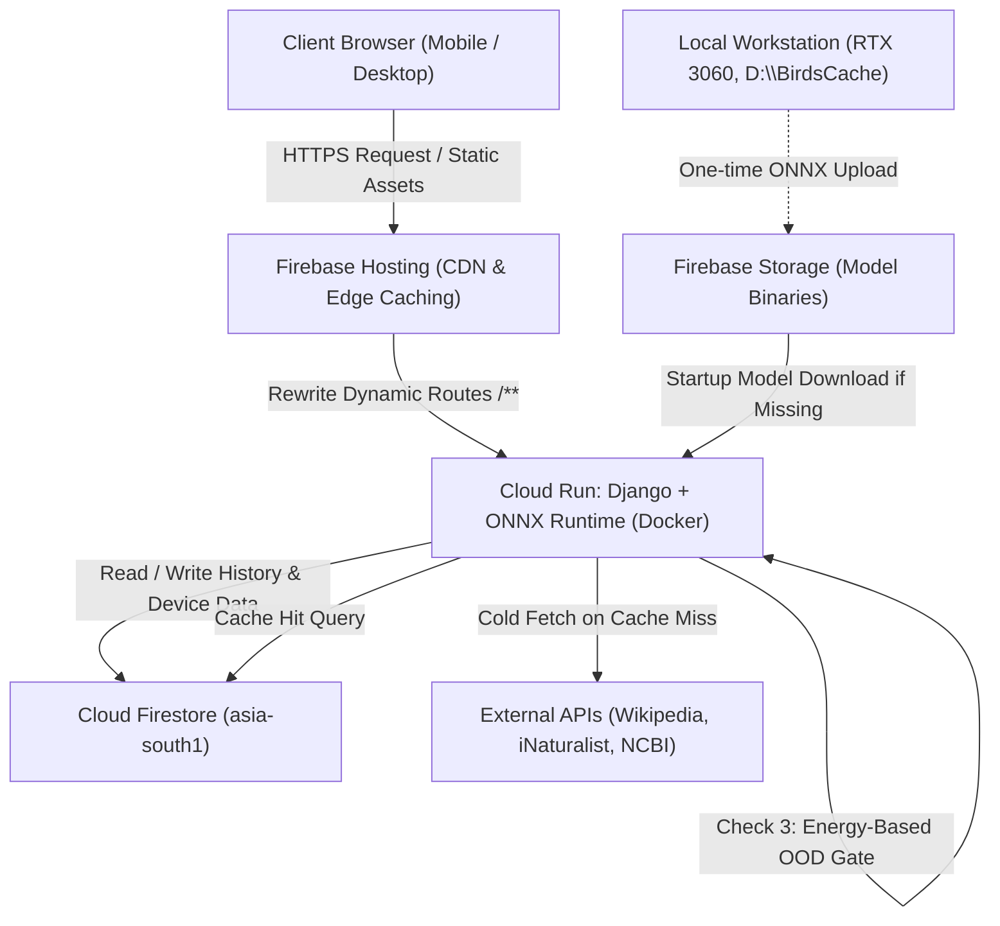
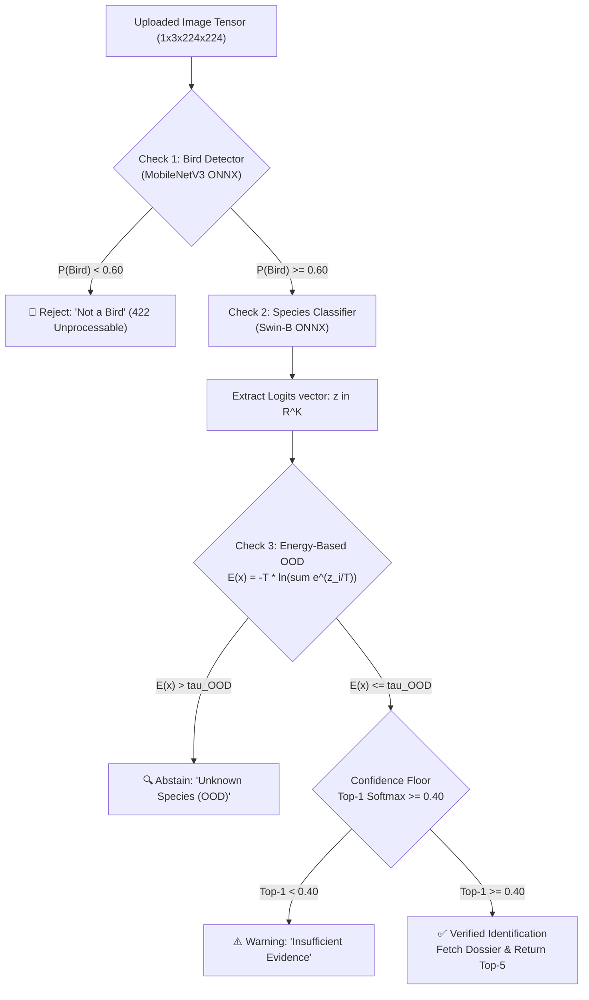

# 🏛️ System Architecture Specification
## Project: Birds Classification & Avian Intelligence System (Feathered Insights)

---

## 1. System Topology Overview

The Birds Classification system employs a hybrid serverless and edge-optimized architecture designed for ultra-low latency, zero-maintenance scaling, and strict operational boundaries.



---

## 2. Technology Stack Breakdown

| Tier | Component | Technology | Rationale |
|---|---|---|---|
| **Frontend** | Presentation | HTML5, Vanilla CSS, Modern JavaScript (ES6+) | Maximum speed, zero build-step overhead, smooth 60fps animations. |
| **Visualizations** | Data Charts | Chart.js 4.x (via CDN) | Lightweight interactive lifespan and probability visualizations. |
| **Edge & CDN** | Reverse Proxy / CDN | Firebase Hosting (`web.app`) | Global edge caching, SSL termination, seamless routing to Cloud Run. |
| **Application Layer** | Web Framework | Django 5.1 (Python 3.11) | Robust request handling, clean module separation, production battle-tested. |
| **WSGI Server** | Application Server | Gunicorn (2 Workers, 120s timeout) | High-concurrency asynchronous worker handling on containerized runtime. |
| **Inference Runtime** | ML Engine | ONNX Runtime (CPU, OpenVINO/MKL) | 3x to 5x faster CPU inference vs. raw PyTorch; eliminates CUDA container bloat. |
| **ML Models** | Vision Transformers | Swin Transformer (`swin_tiny` / `swin_base`) | SOTA hierarchical feature representation for fine-grained plumage details. |
| **OOD Gating** | Binary Gate | MobileNetV3-Small (ONNX, ~8MB) | Ultra-fast (~10ms) verification of bird presence before heavy transformer pass. |
| **Database** | NoSQL Data Store | Google Cloud Firestore (Datastore mode) | Document-oriented, real-time sync, schema-less device history & shared cache. |
| **Asset Storage** | Binary Storage | Firebase Storage (GCS Bucket) | Stores trained ONNX models and high-res specimen reference imagery. |
| **Local Cache** | Workstation Dev | `D:\BirdsCache\` (≤ 5.0 GB) | High-speed NVMe caching for local model checkpoints, datasets, and logs. |

---

## 3. The 3-Check Verification & Inference Pipeline

To eliminate hallucinations and maintain high precision, inference is governed by a sequential 3-tier validation cascade:



### 3.1 Mathematical Formulation of Energy Gating
Instead of relying on the uncalibrated Softmax confidence score (which often produces overconfident predictions on out-of-distribution inputs), the system calculates Helmholtz Free Energy:

$$E(\mathbf{x}; f) = -T \cdot \log \sum_{i=1}^{K} \exp\left(\frac{f_i(\mathbf{x})}{T}\right)$$

Where:
- $f_i(\mathbf{x})$ is the logit for species $i$ before softmax normalization.
- $T$ is the temperature scaling factor (default: $T = 1.0$).
- If $E(\mathbf{x}; f) > \tau_{\text{energy}}$, the input is classified as **Out-of-Distribution (OOD)**, halting classification.

---

## 4. End-to-End Latency & Performance Budget

Target: **Total turnaround time < 2.0 seconds** under real-world network conditions.

| Pipeline Phase | Target Duration (Cached) | Target Duration (Cold) | Mitigation / Optimization Strategy |
|---|---|---|---|
| Client Compression & Upload | 50 ms | 120 ms | Canvas client-side downscale to $< 1\text{ MB}$, bicubic tensor prep. |
| Check 1: Binary Bird Detector | 12 ms | 12 ms | MobileNetV3-Small ONNX FP32 on CPU. |
| Check 2: Swin Transformer Forward | 380 ms | 420 ms | ONNX Runtime CPU multi-threading (`intra_op_num_threads=4`). |
| Check 3: Energy OOD Math | 1 ms | 1 ms | Vectorized NumPy log-sum-exp, instantaneous computation. |
| Firestore History Write | Async (0 ms) | Async (0 ms) | Fire-and-forget background execution via thread pool. |
| Biological Profile Fetch | 80 ms | 550 ms | Shared Firestore `bird_info_cache`; external APIs only on cache miss. |
| Network Roundtrip & Render | 70 ms | 150 ms | Minified JSON payload, Brotli compression via Firebase Hosting. |
| **Total Cumulative Time** | **~593 ms** | **~1,253 ms** | **All scenarios finish safely under 2,000 ms ceiling.** |

---

## 5. Firestore Database Schema & Caching Architecture

### 5.1 Collection: `predictions`
Stores individual prediction entries indexed by anonymous browser device fingerprint.
```
predictions/
  └── {device_id} (Document)
        └── history/ (Sub-collection)
              └── {prediction_id} (Document)
                    ├── species: string ("Indian Peafowl")
                    ├── scientific_name: string ("Pavo cristatus")
                    ├── confidence: float (0.9432)
                    ├── top5: array [ {"species": "...", "prob": 0.9432}, ... ]
                    ├── energy_score: float (-12.45)
                    ├── checks_passed: boolean (true)
                    ├── image_thumb_url: string (optional)
                    └── created_at: timestamp (SERVER_TIMESTAMP)
```

### 5.2 Collection: `bird_info_cache`
Globally shared biological dossier cache. Once any user identifies a species, subsequent queries across all users worldwide hit this cache with sub-100ms latency.
```
bird_info_cache/
  └── {species_slug} (Document, e.g. "indian-peafowl")
        ├── common_name: string ("Indian Peafowl")
        ├── scientific_name: string ("Pavo cristatus")
        ├── taxonomy: map { "kingdom": "Animalia", "class": "Aves", "order": "Galliformes", ... }
        ├── iucn_status: string ("Least Concern")
        ├── habitat: string ("Dense scrub, deciduous forests")
        ├── native_regions: array ["Indian Subcontinent", "Sri Lanka"]
        ├── lifespan: map { "wild_years": [10, 25], "captivity_years": [35, 40] }
        ├── genetics: map { "chromosomes_2n": 76, "ncbi_taxon_id": 9049, "genome_size_gb": 1.05 }
        ├── wiki_summary: string ("The Indian peafowl, also known as the common peafowl...")
        └── last_synced: timestamp
```

---

## 6. Directory Structure & Codebase Organization

```
d:\Birds-classification\Birds-classification\
├── .gitignore                                 # Git exclusion rules (keys, datasets, models)
├── PRD.md                                     # Product Requirements Document
├── Architecture.md                            # System Architecture & Technical Specifications
├── Design.md                                  # UI/UX Blueprint & Design System
├── memory.md                                  # Persistent Project Memory & Decision Log
├── rules.md                                   # AI & Developer Constraints & Coding Standards
├── tracker.md                                 # Phased Execution Roadmap & Task Tracker
├── requirements.txt                           # Production Python dependencies
├── manage.py                                  # Django CLI entry point
├── Dockerfile                                 # Multi-stage production container definition
├── .dockerignore                              # Container build exclusions
├── firebase.json                              # Firebase Hosting rewrites & rules config
├── serviceAccountKey.json                     # Firebase Admin credentials (GIT IGNORED)
├── Bird_class/                                # Core Django project configuration
│   ├── __init__.py
│   ├── settings.py                            # Configured with BaseDir, Firebase & Pathlib
│   ├── urls.py                                # Root URL dispatcher
│   ├── wsgi.py                                # WSGI deployment entry point
│   └── asgi.py                                # ASGI asynchronous entry point
├── myapp/                                     # Avian intelligence application module
│   ├── __init__.py
│   ├── admin.py
│   ├── apps.py
│   ├── urls.py                                # App route mapping
│   ├── views.py                               # Modular request handlers (Upload, Predict, History)
│   ├── ml/                                    # Machine Learning Inference Subsystem
│   │   ├── __init__.py
│   │   ├── detector.py                        # Check 1: MobileNetV3 binary bird validator
│   │   ├── classifier.py                      # Check 2: Swin Transformer ONNX wrapper
│   │   ├── ood_gate.py                        # Check 3: Energy-based OOD & confidence filters
│   │   └── preprocessor.py                    # Bicubic resize & ImageNet tensor normalization
│   ├── services/                              # External Integrations & Caching
│   │   ├── __init__.py
│   │   ├── firebase_client.py                 # Firestore & Firebase Storage singleton client
│   │   ├── bio_enricher.py                    # Wikipedia, iNaturalist & NCBI scrapers
│   │   └── cache_manager.py                   # Local D:\BirdsCache LRU eviction manager
│   ├── data/
│   │   └── cleaned_classes.json               # 200+ canonical species name mappings
│   ├── templates/
│   │   └── myapp/
│   │       ├── base.html                      # Master HTML template (Natural Metallic theme)
│   │       ├── predict.html                   # Main dashboard: Drag-and-drop & dossier card
│   │       ├── history.html                   # Device-keyed prediction log
│   │       └── about.html                     # Model benchmarks & biological methodology
│   └── static/
│       ├── css/
│       │   ├── design-system.css              # Custom HSL tokens, glassmorphism & resets
│       │   └── components.css                 # Upload zone, meter bars, cards, badges
│       └── js/
│           ├── uploader.js                    # Client-side image prep & upload handler
│           ├── visualizer.js                  # Chart.js lifespan & top-5 probability rendering
│           └── history.js                     # Device fingerprinting & history UI
└── D:\BirdsCache\                             # Local NVMe Cache (Dedicated Workstation)
    ├── models/                                # Local .onnx & .pth checkpoints (Max 500MB)
    ├── bird_info/                             # Local JSON biological backups (Max 50MB)
    ├── predictions/                           # Temporary image hashes (Max 200MB, LRU evicted)
    └── logs/                                  # Real-time epoch logs & final metrics (Max 300MB)
```

---

## 7. Security & Cloud Deployment Topology

1. **Credential Isolation**:
   - `serviceAccountKey.json` is strictly maintained in local root and injected into Cloud Run via Google Cloud Secret Manager (`FIREBASE_CREDENTIALS`).
   - `.gitignore` rigorously prevents any accidental Git staging of credentials, local databases, or model binaries.
2. **Containerization (Cloud Run)**:
   - Base image: `python:3.11-slim` with multi-stage build to strip compile dependencies.
   - Non-root user execution (`uid 10001`) for defense-in-depth container security.
   - Resource allocation: 1 vCPU, 2.0 GiB RAM, automatic scale-to-zero when idle to maintain zero ongoing compute cost.
3. **Firebase Hosting Integration**:
   - Dynamic requests rewrites in `firebase.json` automatically pipe `/**` traffic to the Cloud Run service `birds-classification` deployed in `asia-south1` (Mumbai).
